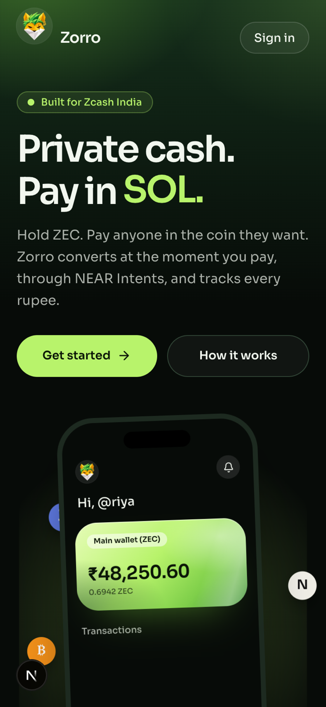
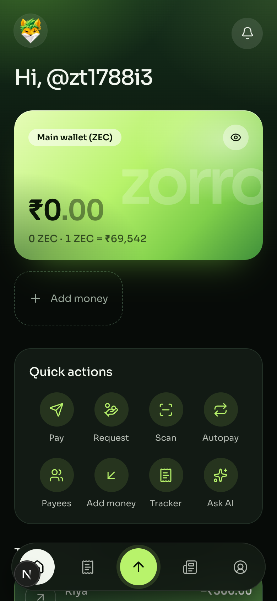
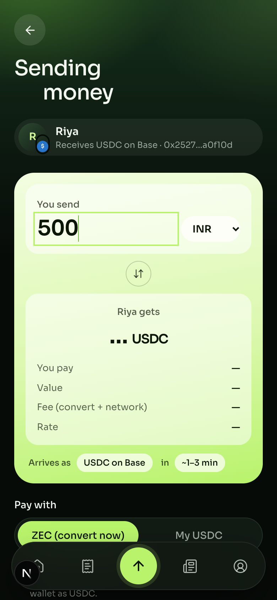
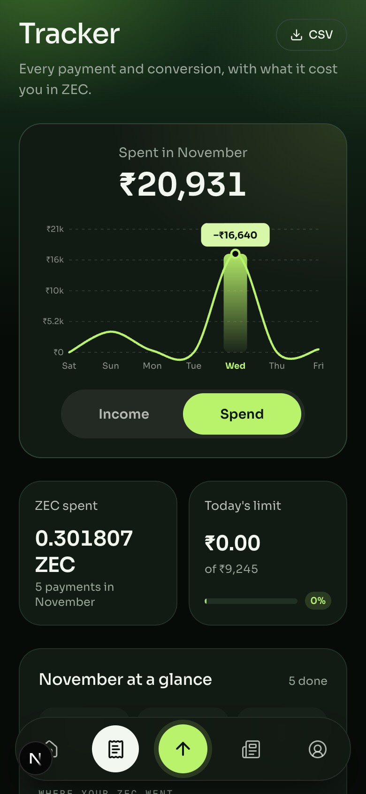

# Zorro

**Private cash for Zcash.** Hold ZEC and pay anyone, or spend at any app, in the coin they want: USDC, USDT, SOL, ETH, BTC, NEAR and more. Zorro converts your ZEC at the moment you pay through [NEAR Intents](https://near-intents.org), runs your regular payments with Autopay, and tracks every conversion. Every payee is approved once with your Face ID, and Zorro can't pay anyone else.

Phone-first web app (installable PWA).

<p align="center">
  
  
  
  
</p>

---

## Why

ZEC is meant to be private money you spend, but the people and apps you pay usually want something else. Today that means swapping first, pasting an address from another wallet, and sending, with no record of what each payment cost you in ZEC and no way to schedule it.

Zorro keeps everything in ZEC and converts only at the edge, when you pay.

## What you can do

| | |
|---|---|
| **Pay anyone, in any coin** | "Send Riya ₹500 in USDC on Base." Enter the amount in INR, USD or the coin, see exactly what it costs in ZEC (fees included), then **slide to pay**. Riya gets the exact amount. |
| **Pay Zorro users instantly** | Pay `@handle`s privately between Zorro wallets, with no conversion and no network fee. |
| **Scan to pay** | Camera or paste: Zcash (ZIP-321), Ethereum/Base/Arbitrum (EIP-681), Solana Pay, Bitcoin (BIP-21), or a plain address. |
| **Autopay** | Rent on the 1st, family every Friday: weekly or monthly at 9:00 AM IST, converted from ZEC on the day. Pause, resume, pay now. |
| **Get paid in anything** | Share a link. The payer picks any of 13 coins and gets a one-time address; NEAR Intents converts it to ZEC on arrival. |
| **Track everything** | Monthly spend, today's limit, a 7-day Income/Spend chart, "where your ZEC went", stacked receipts and CSV export, in INR or USD. |
| **Swap inside the wallet** | ZEC → USDC, SOL, ETH and more (or back), with a live quote, 1% max slippage and slide to swap. |
| **Ask Zorro (voice + chat)** | Talk or type in English or Indian languages (Sarvam AI speech-to-text, Bulbul voice replies, Sarvam-105B). It answers about ZEC, Zorro and your wallet, shows price charts (ZEC, BTC, ETH, SOL, NEAR), and drafts payments, swaps and Autopays for you to review. It never moves money. |
| **Zcash news** | Zcash-only headlines with an AI "today in 30 seconds" brief. |
| **Pay from another wallet** | Pay straight from Zashi/Vizor (or MetaMask/Phantom) via the 1Click API, without holding funds in Zorro. |

**Coins:** ZEC · USDC on Base, Solana, Ethereum, Arbitrum · USDT on Tron, Ethereum, Solana · SOL · ETH on Ethereum and Base · BTC · NEAR. That's 13 coins on 8 chains.

## How it works

```
 Your phone                      Zorro server                          NEAR Intents
 ──────────                      ────────────                          ────────────
 Passkey (Face ID) ───────────►  agent_create: wallet + rules  ──────►  Your wallet: one private
                                 + Zorro's payment permission           (confidential) balance,
                                   (one signature)                      any listed coin

 Add a payee ─► Face ID ──────►  policy_update (destination list) ───►  Only approved payees
                                                                        can ever receive money

 Pay ₹500 to Riya (USDC) ─────►  quote: 0.0073 ZEC + fees
                                 worker: swap ZEC → USDC  ───────────►  inside your wallet
                                         withdraw to Riya  ──────────►  arrives on Base
                                 ledger + receipt
```

- **Your wallet** is a NEAR Intents agent account owned by your passkey. Zorro never holds a seed phrase or private key.
- **Your rules** (signed once): daily USD limit, the coins Zorro may use, and a **destination allow-list**. Adding payees is a `policy_update` signed with Face ID. Several waiting payees are approved with one signature (NEAR Intents allows one rules change every 10 minutes).
- **The payment engine** quotes first, then a background worker runs each payment in steps (convert, then send), one money action per wallet at a time. Every step is saved with its `Idempotency-Key` *before* it is sent, so a crash or timeout is retried with the same key and can never pay twice. Uncertain results are polled, never resent.
- **Exact amounts:** swaps are exact-input, so Zorro converts slightly more ZEC than needed (about 2% buffer, re-quoted) and withdraws exactly what the payee should receive plus the network fee. Leftovers stay in your wallet.

## Safety

- **Money can only go to payees you approved with your passkey**, up to your daily limit. NEAR Intents enforces both, not just Zorro. Even if Zorro's server were compromised, it couldn't add a payee or exceed the limit.
- Zorro's payment permission (grant token) is encrypted at rest (AES-256-GCM, bound to the wallet ID). Only its SHA-256 hash is registered with NEAR Intents.
- Sessions are passkey-only (WebAuthn, user verification required), with no email or password. Session tokens are stored hashed.
- API routes that move money require sign-in and a same-origin request. Public payment links are rate-limited.
- Ask Zorro sends your question (or recording), balances, payee names, Autopays and recent payments to the AI service so it can answer. A guard blocks addresses, keys and tokens before anything is sent. It only drafts: every payment, swap and Autopay is confirmed by you on the normal screen.

## Privacy, honestly

- **Private from the public:** your balance and payment history aren't on a public explorer (confidential balance on NEAR Intents). Zorro-to-Zorro payments never touch a public chain. Payees see only what they received.
- **Not private from everyone:** NEAR Intents and Zorro's server see your payments in order to run them.
- **Not Zcash's shielded pool:** ZEC enters and leaves Zorro through transparent `t1` addresses, a current NEAR Intents limit. Keep long-term savings shielded in a Zcash wallet (Zashi, Vizor) and top up Zorro with spending money.

## Status

Verified end to end on **NEAR Intents mainnet** with a virtual passkey (no money moved):

| Check | Result |
|---|---|
| Create wallet with one Face ID | ACTIVE in ~13 s, own Zcash address approved as first payee |
| Approve a new payee (`policy_update`) | ~5 s |
| Live quote: ₹500 to a USDC-on-Base payee | 5.41 USDC for 0.0073 ZEC + ~₹3 fees (correctly blocked: empty wallet) |
| Payment link paid in USDC on Base | Real deposit address that converts to ZEC on arrival |
| Ask Zorro: "Pay Riya 500 rupees every Friday" | Correct weekly Autopay draft |
| Typecheck, lint, 47 unit tests, production build | Passing |

**Not yet done:** one small real-money payment (and a shielded `u1` delivery test), the live deployment (ready: see Deploy), demo video and the public launch post.

> NEAR Intents' Agent API is an experimental mainnet beta. Use small amounts only.

## Run locally

Requires **Node 22+**.

```bash
cp .env.example .env.local   # fill in the keys (see below)
npm install
npm run db:migrate           # creates ~/.zorro/zorro.db (outside the project; see src/db/url.ts)
npm run dev                  # http://localhost:3000
npm run worker               # second terminal: runs payments, Autopay, payment links, deposits
```

| Variable | Needed for |
|---|---|
| `AGENT_API_KEY` | Wallets, payee approvals, payments, deposits (NEAR Intents **Agent API** key) |
| `ONECLICK_API_KEY` | "Pay from another wallet" and prices (NEAR Intents **1Click** distribution-channel key) |
| `ZORRO_ENCRYPTION_KEY` | Encrypting payment permissions: `openssl rand -base64 32` |
| `SARVAM_API_KEY` | Ask Zorro voice (speech-to-text, text-to-speech) and chat (Sarvam AI) |
| `DEEPSEEK_API_KEY` | Backup chat for Ask Zorro, and the news brief (any OpenAI-compatible API) |
| `NEWS_API_KEY` | Zcash news (NewsAPI.org, or a NewsData.io `pub_…` key) |

Optional: `DATABASE_URL`, `WORKER_TICK_MS` (default 5000), base-URL overrides (see `.env.example`).

**On a phone:** run `npm run dev -- -H 0.0.0.0` and open `http://<your-computer's-LAN-IP>:3000` on the same Wi-Fi. Browsing works over plain HTTP, but **passkeys need HTTPS** on phones (use a tunnel or a deployment). `http://localhost` works on the computer itself.

**Commands:** `npm test` (unit tests) · `npm run typecheck` · `npm run lint` · `npm run build` · `npm run db:generate` (new migration after editing `src/db/schema.ts`).

> Stop the dev server before `npm run build`: building while it runs can corrupt `.next`. If styles look stale after big changes, stop the server and move `.next/dev` aside.

## Deploy (Vercel + Turso, free tiers)

Vercel runs the app and its API; **Turso** hosts the database (SQLite in the cloud). There's no always-on worker on Vercel, so Zorro moves payments **on demand** (right after you confirm, while a receipt is open, and whenever you open Home, Tracker or your payment links), and a **Vercel Cron job** runs Autopay once a day after 9:00 AM IST and keeps finishing payments for up to 5 minutes. A database lease on each payment means two triggers can never run the same step twice.

### 1. Create the Turso database

With the CLI (macOS):

```bash
brew install tursodatabase/tap/turso
turso auth signup            # or: turso auth login
turso db create zorro        # pick a location near your users (e.g. Mumbai) if asked
turso db show zorro --url    # → libsql://zorro-<you>.turso.io   (DATABASE_URL)
turso db tokens create zorro # → a long token                    (DATABASE_AUTH_TOKEN)
```

Or in the dashboard at https://app.turso.tech: **Create database**, then **Connect** shows the URL and lets you create a token.

Create the tables once, from your computer:

```bash
cd zorro
DATABASE_URL="libsql://zorro-<you>.turso.io" DATABASE_AUTH_TOKEN="<token>" npm run db:migrate
# → "Database is up to date."
```

Run the same command again after any future schema change (new files in `drizzle/`).

### 2. Deploy on Vercel

1. Push the repo to GitHub (`.env.local` is git-ignored, so keys stay on your machine).
2. On https://vercel.com: **Add New → Project → import the repo**.
3. **Root Directory: `zorro`** (the app lives in that folder). Framework: Next.js (auto). Node 22 is picked from `package.json`.
4. **Environment Variables** (Production):

   | Name | Value |
   |---|---|
   | `DATABASE_URL` | `libsql://zorro-<you>.turso.io` |
   | `DATABASE_AUTH_TOKEN` | the Turso token |
   | `AGENT_API_KEY` | NEAR Intents Agent API key |
   | `ONECLICK_API_KEY` | NEAR Intents 1Click key |
   | `ZORRO_ENCRYPTION_KEY` | a new `openssl rand -base64 32`. Keep it forever: changing it means every wallet re-authorises Zorro |
   | `CRON_SECRET` | `openssl rand -hex 32` (Vercel sends it to its own cron job) |
   | `SARVAM_API_KEY` | Sarvam AI key (voice + chat) |
   | `DEEPSEEK_API_KEY` | backup AI key |
   | `NEWS_API_KEY` | NewsAPI.org (or NewsData.io) key |

   Don't set `ZORRO_DEMO_MODE`.
5. **Deploy.** Then open `https://<project>.vercel.app/api/health`: every check should be green, and the worker line reads "Serverless mode".
6. **Settings → Cron Jobs** lists `/api/cron/tick` (daily, `0 4 * * *` UTC, about 9:30 AM IST; the free plan runs it within that hour). You can trigger it there with **Run** to test.

### 3. After deploying

- **Sign up again on the live site.** Passkeys belong to the domain they were created on, so local accounts don't carry over (your local database stays on your Mac).
- Optional: a **custom domain** in Vercel → Domains. Create accounts after switching domains, for the same passkey reason.
- Optional, faster Autopay and payment links: a free scheduler such as cron-job.org calling `https://<your-domain>/api/cron/tick` every 5 minutes with the header `Authorization: Bearer <CRON_SECRET>`. (On Vercel Pro you can instead set the schedule in `vercel.json` to `*/5 * * * *`.)
- If Vercel rejects the 5-minute cron time budget on your plan, lower `maxDuration` in `src/app/api/cron/tick/route.ts` (e.g. to 60).

### Other hosts

With an always-on host (Railway, Render, Fly.io, a VPS) run `npm run build && npm start` plus `npm run worker` as a second process; use Turso, or a persistent disk with `DATABASE_URL=file:/data/zorro.db`.

## Project layout

```
src/app/                    screens
  page.tsx                  Home (landing page when signed out)
  landing/                  animated phone landing page
  pay/  pay/[id]/           Pay ("Sending money", slide to pay) and live receipts
  payees/ autopay/ request/ scan/ tracker/ ask/ news/ account/
  wallet/setup  wallet/receive  wallet/swap
  r/[id]/                   public payment link (no account needed)
  swap/ orders/             pay from another wallet (1Click)
src/app/api/                payees, pay/quote, payments, schedules, requests (+ public pay),
                            tracker (+ CSV), wallet/home, agent (wallet, deposits), ai/payment,
                            news, health, auth, me
src/lib/payments.ts         payment engine: quote, queue, convert → send, ledger, CSV
src/lib/payees.ts           payees + Face ID approval (policy_update)
src/lib/schedules.ts        Autopay (9:00 IST)
src/lib/requests.ts         payment links (deposits that convert to ZEC)
src/lib/wallet-service.ts   balances, deposit addresses, deposit tracking
src/lib/agent-service.ts    wallet creation, rules, grants
src/lib/agent-api.ts        typed NEAR Intents Agent API client
src/lib/coins.ts            the 13 coins, address checks, payment URIs
src/lib/scan.ts             payment-code parser (ZIP-321, EIP-681, Solana Pay, BIP-21)
src/lib/rates.ts            coin prices (NEAR Intents) + USD→INR
src/lib/assistant.ts       Ask Zorro: context, actions (charts, drafts, screens), model + fallback
src/lib/sarvam.ts          Sarvam AI: speech-to-text, text-to-speech, chat
src/lib/history.ts         price history for charts (Kraken)
src/lib/ai.ts              AI client with output validation and data guard
src/lib/worker.ts           worker tick (scripts/worker.ts runs it every 5 s), nudges and the Vercel cron run
src/app/api/cron/tick/      Vercel Cron endpoint (Autopay + payment processing), secured by CRON_SECRET
vercel.json                 cron schedule
src/components/             UI: money, SlideToConfirm, SpendChart, landing/, shell/ (tab bar)
drizzle/                    database migrations
docs/screenshots/           README images
brand/                      logo source
```

## Tech

Next.js 16 (App Router, Cache Components, Turbopack) · React 19 · TypeScript · Tailwind CSS 4 · libsql/SQLite with Drizzle · WebAuthn via `@simplewebauthn` · zod · Vitest · `jsqr` for camera scanning · Sora font. Animations are plain CSS and small hooks and respect "reduce motion". UI uses frosted glass panels over soft ambient light.

Coin and network logos: [@web3icons/core](https://github.com/0xa3k5/web3icons) (MIT), see `public/coins/CREDITS.txt`. They are trademarks of their projects, used only to identify each asset.

## History

Zorro started as a ZEC trading-bot app (stop-loss, DCA, grid). After feedback from the Zcash community that the ecosystem sees ZEC as **private cash, not a trading asset**, it was rebuilt as a payments app. The bot code remains in git history. See [PLAN.md](PLAN.md) for the full design and decisions.
